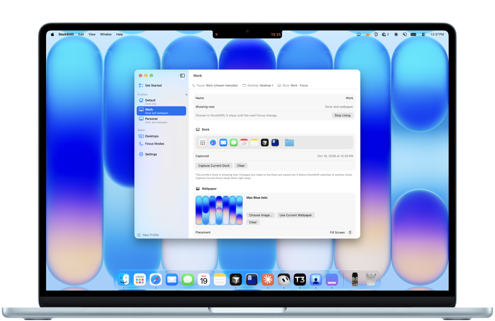
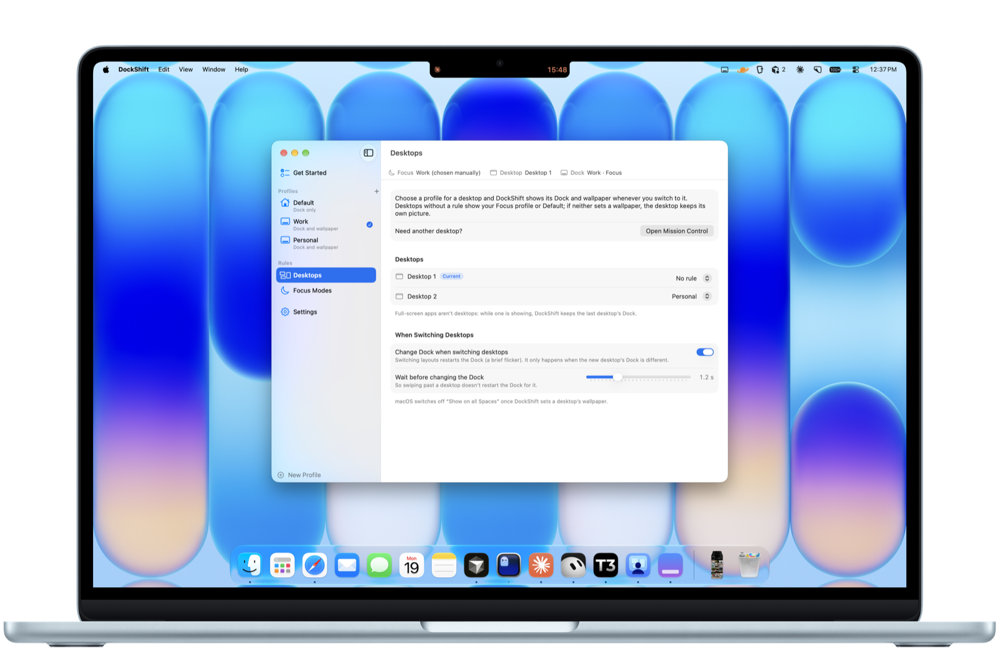
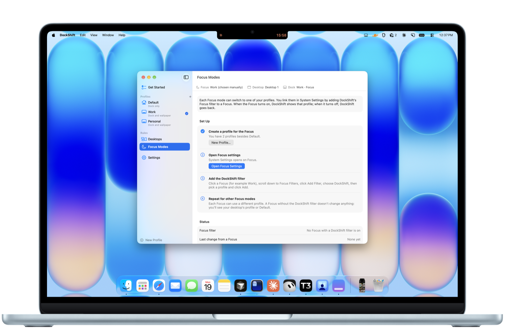

# DockShift

**Give every Focus mode and every desktop on your Mac its own Dock and its own wallpaper.**

Turn on your *Work* Focus and the Dock shrinks to your work apps with a work wallpaper. Turn it
off and your normal Dock comes back. Swipe to Desktop 2 and it can have a Dock and wallpaper of its
own, too.

<p align="center"></p>

- Lives in the menu bar; no Dock icon.
- Uses Apple's own **Focus filters**, so it works however a Focus turns on: manually, on a
  schedule, by location, or synced from your iPhone.
- **Per-desktop** Docks and wallpapers that follow your four-finger swipes.
- Puts your own wallpaper back when a rule stops applying, and has a one-click **Restore Original**.

<table>
  <tr>
    <td></td>
    <td></td>
  </tr>
  <tr>
    <td align="center">Give each desktop its own profile</td>
    <td align="center">Link Focus modes with a Focus filter</td>
  </tr>
</table>

## Requirements

- macOS 15 Sequoia or later (built and tested on macOS 27).
- Apple silicon or Intel.

## Install

1. Download **`DockShift-x.y.z.dmg`** from the [latest release](https://github.com/quentinsteinke/DockShift/releases/latest).
2. Open it and drag **DockShift** into **Applications**.
3. Open DockShift from Applications.

**First launch:** DockShift is free and open source, but it isn't notarized by Apple, so macOS blocks
it the first time:

1. Open DockShift. macOS says it can't verify the app — click **Done**.
2. Go to **System Settings › Privacy & Security**, scroll down to the message about DockShift and click
   **Open Anyway**, then confirm with your password.

Or, in Terminal: `xattr -dr com.apple.quarantine /Applications/DockShift.app`

DockShift appears in the menu bar (a small Dock icon). On first launch it saves your current Dock as
the **Default** profile and an untouched **Original** copy. Nothing on screen changes until you add a rule.

> DockShift has to be running to react to Focus changes. Turn on
> **Settings › Open DockShift at login**.

## Quick start

### 1. Save profiles

A **profile** is a Dock layout plus a wallpaper. Either half can be left empty, and the next rule
(or Default) fills it in.

- Arrange your Dock (and wallpaper) the way you want them, then choose
  **Create Profile from Current Setup…** (or **New Profile** in the sidebar).
- On a profile's page you can **Capture Current Dock**, **Choose Image…** for the wallpaper,
  **Use Current Wallpaper**, and set the placement.
- To build a Dock for a profile: open it, click **Use Now**, arrange the Dock, then click
  **Capture Current Dock**. Click **Stop Using** when you're done.

### 2. Link Focus modes

1. Click **Open Focus Settings** in DockShift (or go to **System Settings › Focus**).
2. Pick a Focus (e.g. *Work*) › **Focus Filters** › **Add Filter…** › **DockShift**.
3. Choose a profile and click **Add**.

When that Focus turns on, its profile's Dock and wallpaper appear; when it turns off, DockShift
switches back. Repeat for each Focus.

<details>
<summary>Backup option: Shortcuts automations</summary>

If a Focus filter ever doesn't fire, you can drive DockShift from Shortcuts instead (macOS 26+):
**Shortcuts › Automation › New › Focus › *your Focus* › Is Turned On** → action
**Set DockShift Focus Profile** (pick the profile). Add a second automation for **Is Turned Off**
with the same action and no profile.
</details>

### 3. Give desktops their own profile

Open **Desktops** in DockShift's sidebar and pick a profile for any desktop. Switching to that desktop
(four-finger swipe, Control-arrow, Mission Control) shows its Dock and wallpaper.

## Using it day to day

The menu bar menu shows what's active (Focus, desktop, and where the Dock and wallpaper come from) and has:

| Item | What it does |
|---|---|
| **Apply Profile** | Use a profile right now; it stays until the Focus next changes. |
| **Save Current Dock to Profile** | Save the Dock as it is now into the profile that's showing. |
| **Pause DockShift** | Stop switching anything until you resume. |
| **Restore Original Dock & Wallpaper…** | Put back the Dock from first launch and every wallpaper DockShift replaced, then pause. |
| **Open DockShift…** | The main window. |

Settings worth knowing (in **Settings** and on the **Desktops** page):

- **When Rules Overlap** — if a Focus and the current desktop both pick a profile, the Focus wins by
  default. You can flip that separately for the Dock and the wallpaper.
- **Remember manual Dock edits** — when you add or remove apps by hand, the change is saved into the
  profile that's showing before DockShift switches away from it.
- **Change Dock when switching desktops** / **Wait before changing the Dock** (Desktops page) — turn
  per-desktop Docks off, or make DockShift wait longer before switching.

## Good to know

- **The Dock blinks when it changes.** macOS only reads the Dock's app list when the Dock starts, so a
  different layout means a quick Dock restart (about a third of a second). DockShift skips it when
  the layout doesn't change and won't restart while you're dragging. If anything ever loops, it stops
  itself after too many restarts in a minute.
- **"Show on all Spaces" turns off** once DockShift gives one desktop its own wallpaper (that's how
  macOS stores per-desktop wallpapers). Turn it back on in System Settings › Wallpaper if you stop
  using per-desktop wallpapers.
- **Your wallpaper comes back.** For every desktop DockShift changes, it remembers what was there and
  puts it back when no rule wants that desktop any more. Live/Aerial wallpapers can't be saved as a
  file; those come back as Apple's still image, and DockShift tells you.
- **Private APIs.** Telling desktops apart and setting a wallpaper on a desktop you're not looking at
  use private macOS APIs. They're loaded at runtime, so if a future macOS removes them, the Focus
  features keep working and DockShift says that desktop rules are unavailable.
- **Not sandboxed.** DockShift changes the Dock's settings (`com.apple.dock`), which a sandboxed app can't.
  It makes no network connections.

## Troubleshooting

- **DockShift isn't listed under Add Filter.** Make sure it's in `/Applications`, open it once,
  then quit and reopen System Settings.
- **Nothing changes when a Focus turns on.** DockShift must be running (enable *Open DockShift at
  login*). Check **Focus Modes** in DockShift's sidebar for the filter's status, or use the Shortcuts
  backup option above.
- **See what it's doing:**
  `log stream --level debug --predicate 'subsystem == "com.quentinsteinke.DockShift"'`
  (or **Settings › Show Logs…**).

## Uninstall

1. Menu › **Restore Original Dock & Wallpaper…**
2. Remove DockShift's filter from each Focus in **System Settings › Focus**.
3. Quit DockShift, delete it from Applications, and delete `~/Library/Application Support/DockShift`.

## Build from source

Built with Xcode 27 and [XcodeGen](https://github.com/yonaskolb/XcodeGen) (`brew install xcodegen`).

```bash
git clone https://github.com/quentinsteinke/DockShift.git
cd DockShift
ADHOC=1 scripts/build.sh Release        # or DEVELOPMENT_TEAM=<your team ID> scripts/build.sh
open build/Build/Products/Release/DockShift.app
```

- `scripts/release.sh` builds the universal, ad-hoc signed `.dmg` and `.zip` published on the Releases page.
- `scripts/install.sh` builds with the team in `project.yml` and installs to `/Applications`.
- Run it from `/Applications`: the Focus filter and the login item bind to the copy macOS has registered.

| Path | What |
|---|---|
| `DockShift/Sources/Engine/Engine.swift` | The reconciler: Focus + desktop + rules → what to show, and when it's safe to restart the Dock |
| `DockShift/Sources/Engine/WallpaperSync.swift` | Wallpaper per display × desktop, with remembered originals |
| `DockShift/Sources/Services/DockService.swift` | Capture, write, restart and verify the Dock |
| `DockShift/Sources/Services/SpaceMonitor.swift` | Desktop (Space) detection |
| `DockShift/Sources/Services/FocusRouter.swift` | Focus filter events, Shortcuts and manual choices |
| `DockShift/Sources/Intents/Intents.swift` | The Focus filter and Shortcuts action |
| `DockShift/Sources/Model/` | Data types, storage, rule resolution |
| `DockShift/Sources/UI/` | Menu bar menu and main window |

## License

[MIT](LICENSE)
