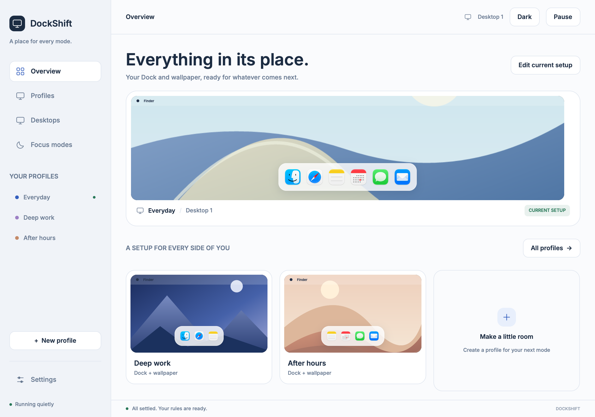
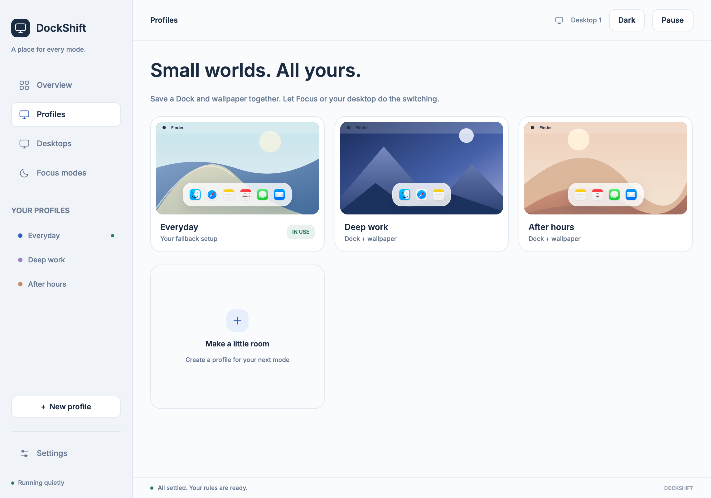
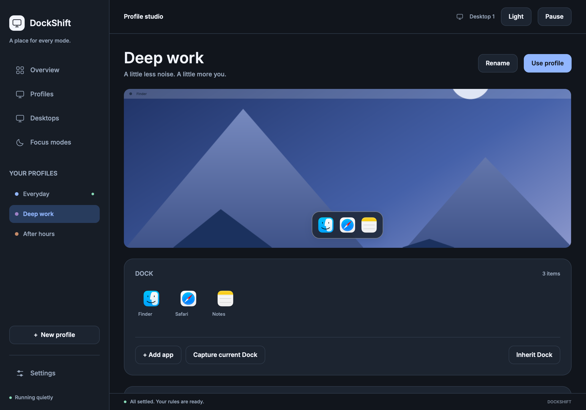

# DockShift

**Give every Focus mode and every desktop on your Mac its own Dock and its own wallpaper.**

Turn on your *Work* Focus and the Dock shrinks to your work apps with a work wallpaper. Turn it
off and your normal Dock comes back. Swipe to Desktop 2 and it can have a Dock and wallpaper of its
own, too.

DockShift 0.3.0 uses [Rune](https://github.com/anomalyco/rune) for the main window,
Profile Studio, desktop rules, settings, and menu-bar controls. Screenshots below use sample profiles.

<p align="center"></p>

- Lives in the menu bar; no Dock icon.
- Uses Apple's own **Focus filters**, so it works however a Focus turns on: manually, on a
  schedule, by location, or synced from your iPhone.
- **Per-desktop** Docks and wallpapers that follow your four-finger swipes.
- Puts your own wallpaper back when a rule stops applying, and has a one-click **Restore Original**.

<table>
  <tr>
    <td></td>
    <td></td>
  </tr>
  <tr>
    <td align="center">Your profiles at a glance</td>
    <td align="center">Edit the Dock and wallpaper together</td>
  </tr>
</table>

## Requirements

- macOS 15 Sequoia or later (built and tested on macOS 27).
- Apple silicon or Intel.

## Install

1. Download **`DockShift-x.y.z.dmg`** from the [latest release](https://github.com/quentinsteinke/DockShift/releases/latest).
2. Open it and drag **DockShift** into **Applications**.
3. Open DockShift from Applications.

Releases are signed with Developer ID and notarized by Apple. Users on 0.2.0 can choose
**Check for Updates…** to install 0.3.0. Automatic checks also offer the update.

DockShift appears in the menu bar (a small Dock icon). On first launch it saves your current Dock as
the **Default** profile and an untouched **Original** copy. Nothing on screen changes until you add a rule.

> DockShift has to be running to react to Focus changes. Turn on
> **Settings › Open DockShift at login**.

## Quick start

### 1. Save profiles

A **profile** is a Dock layout plus a wallpaper. Either half can be left empty, and the next rule
(or Default) fills it in.

- Arrange your Dock (and wallpaper) the way you want them, then choose
  **Create Profile from Current Setup…** (or **New Profile** in the sidebar).
- On a profile's page you can **Capture Current Dock**, **Choose Image…** for the wallpaper,
  **Use Current Wallpaper**, and set the placement.
- In **Profile Studio**, select an app to move it left or right or remove it. **Add app** opens
  the Applications picker. These edits change the saved profile; using that profile applies them.
- You can also click **Use profile**, arrange the real Dock, then click **Capture current Dock**.
  Click **Stop using** when you're done.

### 2. Link Focus modes

1. Click **Open Focus Settings** in DockShift (or go to **System Settings › Focus**).
2. Pick a Focus (e.g. *Work*) › **Focus Filters** › **Add Filter…** › **DockShift**.
3. Choose a profile and click **Add**.

When that Focus turns on, its profile's Dock and wallpaper appear; when it turns off, DockShift
switches back. Repeat for each Focus.

<details>
<summary>Backup option: Shortcuts automations</summary>

If a Focus filter ever doesn't fire, you can drive DockShift from Shortcuts instead (macOS 26+):
**Shortcuts › Automation › New › Focus › *your Focus* › Is Turned On** → action
**Set DockShift Focus Profile** (pick the profile). Add a second automation for **Is Turned Off**
with the same action and no profile.
</details>

### 3. Give desktops their own profile

Open **Desktops** in DockShift's sidebar and pick a profile for any desktop. Switching to that desktop
(four-finger swipe, Control-arrow, Mission Control) shows its Dock and wallpaper.

## Using it day to day

The menu bar menu shows what's active (Focus, desktop, and where the Dock and wallpaper come from) and has:

| Item | What it does |
|---|---|
| **A profile button** | Use that profile until the Focus next changes. |
| **Capture current Dock** | Save the Dock into the profile that's showing. |
| **Follow Focus and desktop rules** | Clear a manual profile choice. |
| **Pause switching** | Stop switching anything until you resume. |
| **Restore original…** | Put back the saved original Dock and wallpapers, then pause. |
| **Open DockShift** | The main window. |

Settings worth knowing (in **Settings** and on the **Desktops** page):

- **When Rules Overlap** — if a Focus and the current desktop both pick a profile, the Focus wins by
  default. You can flip that separately for the Dock and the wallpaper.
- **Remember manual Dock edits** — when you add or remove apps by hand, the change is saved into the
  profile that's showing before DockShift switches away from it.
- **Change Dock when switching desktops** / **Wait before changing the Dock** (Desktops page) — turn
  per-desktop Docks off, or make DockShift wait longer before switching.

## Good to know

- **The Dock blinks when it changes.** macOS only reads the Dock's app list when the Dock starts, so a
  different layout means a quick Dock restart (about a third of a second). DockShift skips it when
  the layout doesn't change and won't restart while you're dragging. If anything ever loops, it stops
  itself after too many restarts in a minute.
- **"Show on all Spaces" turns off** once DockShift gives one desktop its own wallpaper (that's how
  macOS stores per-desktop wallpapers). Turn it back on in System Settings › Wallpaper if you stop
  using per-desktop wallpapers.
- **Your wallpaper comes back.** For every desktop DockShift changes, it remembers what was there and
  puts it back when no rule wants that desktop any more. Live/Aerial wallpapers can't be saved as a
  file; those come back as Apple's still image, and DockShift tells you.
- **Private APIs.** Telling desktops apart and setting a wallpaper on a desktop you're not looking at
  use private macOS APIs. They're loaded at runtime, so if a future macOS removes them, the Focus
  features keep working and DockShift says that desktop rules are unavailable.
- **Not sandboxed.** DockShift changes the Dock's settings (`com.apple.dock`), which a sandboxed app can't.
  Configured updater builds contact GitHub to check for updates and download an update only after you
  choose to install it. Update checks do not send your profiles or system statistics.

## Updates

Starting with the updater-enabled release, DockShift checks for updates daily while it is running.
It shows an update offer, then downloads, verifies, installs and relaunches when you choose to update.
You can also choose **Check for Updates…** in the menu or Settings. Turn off automatic checks in
Settings if you prefer to check manually. Your profiles, saved Docks and wallpapers stay in
`~/Library/Application Support/DockShift` across updates.

The existing v0.1.0 release has no updater. Install the first updater-enabled release manually once.
Source builds without a configured signing key show that updates are not configured.

## Troubleshooting

- **DockShift isn't listed under Add Filter.** Make sure it's in `/Applications`, open it once,
  then quit and reopen System Settings.
- **Nothing changes when a Focus turns on.** DockShift must be running (enable *Open DockShift at
  login*). Check **Focus Modes** in DockShift's sidebar for the filter's status, or use the Shortcuts
  backup option above.
- **See what it's doing:**
  `log stream --level debug --predicate 'subsystem == "com.quentinsteinke.DockShift"'`
  (or **Settings › Show Logs…**).

## Uninstall

1. Menu › **Restore Original Dock & Wallpaper…**
2. Remove DockShift's filter from each Focus in **System Settings › Focus**.
3. Quit DockShift, delete it from Applications, and delete `~/Library/Application Support/DockShift`.

## Build from source

Build with Xcode 27, [XcodeGen](https://github.com/yonaskolb/XcodeGen) (`brew install xcodegen`),
and [rustup](https://rustup.rs). The build helper selects Rust 1.99.1 and builds the pinned Rune
revision into an embedded dylib before compiling the Swift host. Local builds target the current
Mac; the release helper builds both Apple silicon and Intel slices.

```bash
git clone https://github.com/quentinsteinke/DockShift.git
cd DockShift
scripts/build.sh Release        # or DEVELOPMENT_TEAM=<your team ID> scripts/build.sh
open /tmp/DockShift-build/Build/Products/Release/DockShift.app
```

- `scripts/release.sh` prepares signed, notarized universal `.dmg` and `.zip` files and a signed update
  feed. It does not publish them. See [Update release setup](docs/updates.md).
- `scripts/install.sh` builds with the team in `project.yml` and installs to `/Applications`.
- Run it from `/Applications`: the Focus filter and the login item bind to the copy macOS has registered.
- `scripts/test-updates.sh` checks update configuration. Use `scripts/prepare-update-fixture.sh` for
  isolated macOS installation tests, as described in the update setup guide.
- `scripts/test-rune.sh` runs interaction tests and generates screenshots, element trees, and
  a short motion demo under `build/rune-review/final`. These use synthetic profiles and change
  no desktop settings. Video generation uses `ffmpeg` when installed.
- `scripts/test-wallpapers.sh` verifies baseline capture and delayed verification with service doubles.
- The renderer can run without the app: `build/rune-target/release/dockshift-preview`.
  `--scene studio-dark --snap /tmp/studio.png` renders a screen headlessly.
- `scripts/run-rune-preview.sh` builds and opens a paused native preview with disposable sample
  profiles and a separate bundle identifier. The installed app's profiles and preferences remain
  separate. Resuming this preview enables real Dock and wallpaper switching.

| Path | What |
|---|---|
| `DockShift/Sources/Engine/Engine.swift` | The reconciler: Focus + desktop + rules → what to show, and when it's safe to restart the Dock |
| `DockShift/Sources/Engine/WallpaperSync.swift` | Wallpaper per display × desktop, with remembered originals |
| `DockShift/Sources/Services/DockService.swift` | Capture, write, restart and verify the Dock |
| `DockShift/Sources/Services/SpaceMonitor.swift` | Desktop (Space) detection |
| `DockShift/Sources/Services/FocusRouter.swift` | Focus filter events, Shortcuts and manual choices |
| `DockShift/Sources/Intents/Intents.swift` | The Focus filter and Shortcuts action |
| `DockShift/Sources/Model/` | Data types, storage, rule resolution |
| `RuneUI/src/view/` | Rune screens, profile previews, controls and dialogs |
| `DockShift/Sources/UI/RuneHost.swift` | Metal hosting, native input and accessibility |
| `DockShift/Sources/UI/RuneBridge.swift` | Value snapshots and commands to the Swift engine |

## License

[MIT](LICENSE)
